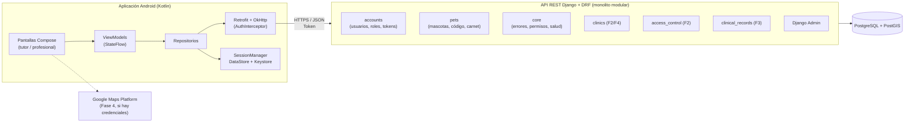
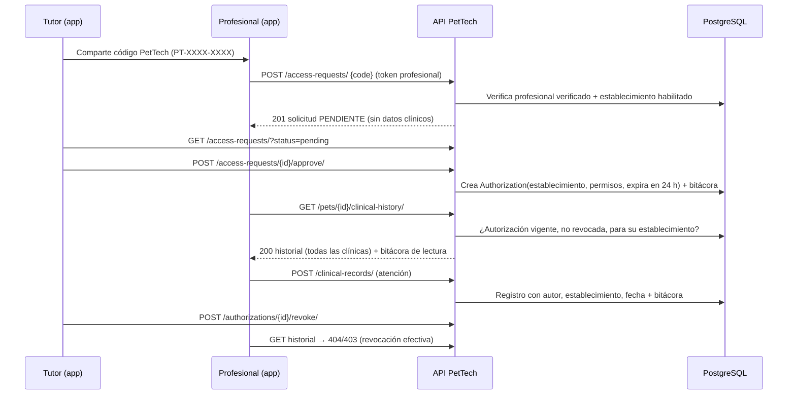

# Arquitectura de PetTech

Coherente con el capítulo VII del Informe 1 (arquitectura cliente-servidor de tres capas, API como único servicio
desplegable organizado por dominios, descarte justificado de microservicios) y ajustada a la retroalimentación del
profesor (historial clínico compartido como núcleo).

## 1. Vista de componentes

## 2. Responsabilidades

| Componente | Responsabilidad | Tecnología | Estado |
|---|---|---|---|
| App Android | Interfaz por rol, validación de formularios (no autoritativa), sesión cifrada, consumo de la API | Kotlin, Jetpack Compose, Material 3, Navigation Compose, Retrofit, OkHttp, kotlinx.serialization, DataStore | Incremento 1 escrito (ver estado) |
| `accounts` | Registro de tutores, inicio/cierre de sesión, roles, tokens con expiración por rol | Django, DRF, django-rest-knox, Argon2 | ✅ |
| `pets` | CRUD de mascotas propias, código PetTech, carnet | DRF ViewSet con queryset filtrado por titular | ✅ |
| `core` | Formato de errores, permisos (`IsTutor`), paginación, `/health/`, datos demo | DRF | ✅ |
| `clinics` | Establecimientos (con `PointField`), profesionales, membresías, verificación; catálogo y búsqueda geográfica | GeoDjango / PostGIS | Fase 2 y 4 |
| `access_control` | Solicitudes, autorizaciones temporales, revocación, bitácora de auditoría | DRF + transacciones | Fase 2 |
| `clinical_records` | Atenciones, vacunas, alergias, correcciones versionadas | DRF | Fase 3 |
| Django Admin | Gestión interna: usuarios, establecimientos, verificación de profesionales, supervisión | `django.contrib.admin` | Usuarios ✅; mascotas solo lectura ✅ |
| PostgreSQL + PostGIS | Persistencia relacional, restricciones de integridad, consultas espaciales | PostgreSQL 16, PostGIS 3.4 | ✅ (local) |

## 3. Flujo de autorización (núcleo, Fases 2–3)

## 4. Decisiones arquitectónicas clave

Detalle y alternativas en [`DECISIONES.md`](DECISIONES.md).

- **Monolito modular** (DEC-002): un desplegable, una base de datos, apps por dominio. Adecuado al volumen del piloto y a un equipo de dos.
- **Autorización en el servidor** en cada operación (DEC-008): la app solo adapta la interfaz.
- **Tokens con hash y expiración** (DEC-006) en lugar de sesiones con cookies: cliente móvil, sin CSRF.
- **PostGIS desde el incremento 1** (DEC-003): todas las pruebas corren contra el motor real.
- **Separación de ambientes** (DEC-004): `development.py` (DEBUG, HTTP local, OpenAPI pública) y `production.py` (HTTPS, HSTS, cookies seguras, OpenAPI solo administradores, validación de `SECRET_KEY`).

## 5. Integraciones

| Integración | Uso | Estado |
|---|---|---|
| Google Maps Platform (Maps SDK for Android) | Mapa de establecimientos (HU-10) | ⛔ Requiere clave con facturación habilitada. Alternativa sin clave: lista por distancia + botón "Cómo llegar" que abre la app de mapas del teléfono (intent `geo:`). |
| WorkManager | Recordatorios locales (HU-06) | ⏳ Fase 4 |
| Correo electrónico | Recuperación de contraseña (HU-01) | ⏳ Sin proveedor definido (C-09) |
| Render + PostgreSQL gestionado con PostGIS (Supabase) | Despliegue del piloto (Informe 1, sección 6.4) | ⏳ Fase 5 |

## 6. Atributos de calidad

| Atributo | Mecanismo |
|---|---|
| Seguridad | Argon2id; tokens SHA-512 con TTL por rol y revocación; denegación por defecto; `IsTutor`; querysets por titular; *throttling* 10/min en autenticación; errores sin trazas; HTTPS/HSTS en producción; `cleartext` solo en *debug*; sesión cifrada con Android Keystore; sin respaldo de datos locales |
| Privacidad | Minimización (sin RUT, teléfono ni dirección del tutor); consentimiento versionado; ubicación no almacenada (F4) |
| Mantenibilidad | Apps por dominio; `services.py`; OpenAPI; MVVM en Android; versiones fijadas |
| Integridad | `UNIQUE` (correo sin mayúsculas, código PetTech); `CHECK` (roles, especies, sexo, nombre no vacío); `PROTECT` en titularidad |
| Observabilidad | Registro estructurado por módulo (`pettech.*`) sin datos sensibles; `/health/` para monitor externo (NS-01) |
| Rendimiento | Índice `(owner, name)`; paginación; índices espaciales GiST en F4 |
