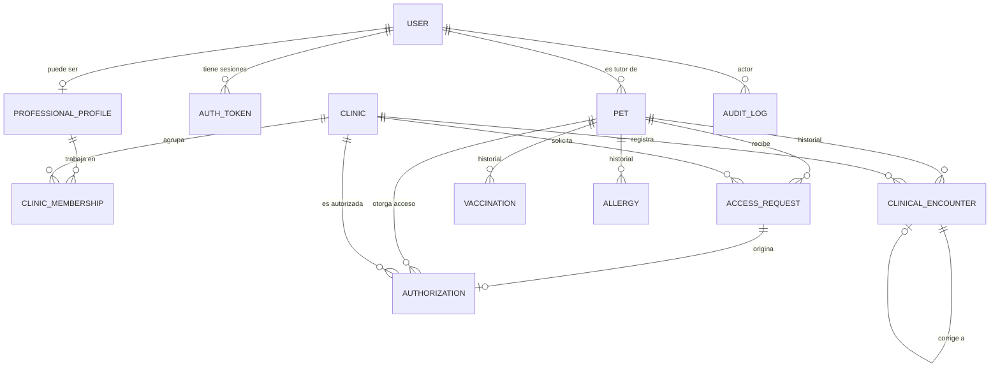

# Modelo de datos

Base de datos: **PostgreSQL 16 + PostGIS 3.4**, accedida solo mediante el ORM de Django (consultas parametrizadas).
Fechas en UTC (`timestamptz`), presentadas en `America/Santiago`.

Leyenda: ✅ implementado (migración aplicada y probada) · 📐 diseñado para la fase indicada (puede ajustarse).

## 1. Diagrama entidad-relación

## 2. Entidades implementadas (incremento 1)

### `accounts_user` ✅ — Usuario
| Atributo | Tipo | Restricciones / notas |
|---|---|---|
| `id` | UUID | PK, `uuid4` (no secuencial: resiste enumeración) |
| `email` | varchar(254) | `UNIQUE`; `UNIQUE (lower(email))`; se normaliza a minúsculas |
| `password` | varchar(128) | Hash Argon2id gestionado por Django (nunca texto plano) |
| `full_name` | varchar(150) | obligatorio |
| `role` | varchar(20) | `CHECK role IN ('TUTOR','PROFESSIONAL','ADMIN')`; por defecto TUTOR |
| `is_active` | boolean | suspensión sin borrar datos; un token de cuenta suspendida deja de funcionar |
| `is_staff`, `is_superuser` | boolean | acceso a Django Admin; **no** otorgan permisos clínicos |
| `date_joined`, `last_login` | timestamptz | |
| `privacy_policy_version` | varchar(40) | versión aceptada (HU-01) |
| `privacy_policy_accepted_at` | timestamptz | fecha del consentimiento |

Minimización (RNF-03): no se almacenan RUT, teléfono ni dirección del tutor.

### `knox_authtoken` ✅ — Sesión (token)
| Atributo | Tipo | Notas |
|---|---|---|
| `digest` | varchar(128) | PK; hash SHA-512 del token (el token completo solo lo conoce el cliente) |
| `token_key` | varchar(25) | prefijo indexado para búsqueda |
| `user_id` | UUID | FK → usuario, `ON DELETE CASCADE` |
| `created`, `expiry` | timestamptz | TTL: tutor 7 días; profesional 12 h; admin 8 h |

Máximo 5 sesiones simultáneas por usuario (las más antiguas se revocan).

### `pets_pet` ✅ — Mascota
| Atributo | Tipo | Restricciones / notas |
|---|---|---|
| `id` | UUID | PK interna, `uuid4` |
| `public_code` | varchar(12) | `UNIQUE`; formato `PT-XXXX-XXXX` (Base32 Crockford, `secrets`); inmutable; **no es credencial** |
| `owner_id` | UUID | FK → usuario, **`ON DELETE PROTECT`** (ver DEC-009) |
| `name` | varchar(60) | obligatorio; `CHECK name <> ''` |
| `species` | varchar(10) | `CHECK species IN ('DOG','CAT')` (delimitación del Informe 1) |
| `breed` | varchar(60) | opcional |
| `sex` | varchar(10) | `CHECK sex IN ('MALE','FEMALE','UNKNOWN')` |
| `birth_date` | date | opcional; no futura ni > 40 años (validación de servidor) |
| `birth_date_is_estimated` | boolean | por defecto `true` |
| `microchip_number` | varchar(15) | opcional; 15 dígitos (ISO 11784); **declarado, no verificado, no único** |
| `general_notes` | text (≤ 1000) | antecedentes generales **declarados por el tutor** |
| `created_at`, `updated_at` | timestamptz | |

Índice: `pets_owner_name_idx (owner_id, name)`. En la API se expone `data_origin = "OWNER_DECLARED"`.

## 3. Entidades diseñadas (fases 2–4)

### `clinics_clinic` 📐 F2/F4 — Establecimiento
`id` UUID · `name` · `legal_name` (opc.) · `phone` · `email` · `address` · `commune` · `region` ·
`location` **`PointField(srid=4326)`** con índice GiST · `status` (`PENDING`, `ACTIVE`, `SUSPENDED`) ·
`verification_origin` (`CONFIRMED_BY_CLINIC`, `PUBLIC_SOURCE_UNCONFIRMED`) · `verified_at` · `is_pilot_collaborator` ·
horarios y servicios en tablas hijas (`clinic_opening_hours`: día, apertura, cierre; `clinic_service`) ·
`emergency_level` declarado. Restricción: solo `ACTIVE` puede solicitar accesos.

### `clinics_professionalprofile` 📐 F2 — Profesional
`user_id` (OneToOne, rol PROFESSIONAL) · `license_reference` (texto declarado; verificación manual) ·
`verification_status` (`PENDING`, `VERIFIED`, `REJECTED`, `SUSPENDED`) · `verified_by` (admin) · `verified_at`.

### `clinics_clinicmembership` 📐 F2 — Vínculo profesional ↔ establecimiento
`professional_id` · `clinic_id` · `role_in_clinic` · `is_active` · `start_date` · `end_date`.
`UNIQUE (professional_id, clinic_id)`. Un profesional opera "en nombre de" un establecimiento activo.

### `access_control_accessrequest` 📐 F2 — Solicitud de acceso
`id` UUID · `pet_id` · `clinic_id` · `requested_by` (profesional) · `owner_id` (destinatario, copiado de la mascota) ·
`reason` · `status` (`PENDING`, `APPROVED`, `REJECTED`, `CANCELLED`, `EXPIRED`) · `created_at` · `resolved_at`.
Restricción parcial: una sola solicitud `PENDING` por (`pet`, `clinic`).

### `access_control_authorization` 📐 F2 — Autorización
`id` UUID · `pet_id` · `clinic_id` · `granted_by` (tutor) · `request_id` · `can_read` · `can_write` ·
`starts_at` · `expires_at` (por defecto +24 h, configurable) · `revoked_at` · `revoked_by`.
`CHECK expires_at > starts_at`. **Vigente** ⇔ `revoked_at IS NULL AND now() BETWEEN starts_at AND expires_at`.
La autorización es del **establecimiento**; el profesional debe además tener membresía activa.

### `clinical_records_clinicalencounter` 📐 F3 — Atención clínica
`id` UUID · `pet_id` · `clinic_id` · `professional_id` · `attended_at` · `reason` · `observations` ·
`procedures` · `treatment` · `next_control_date` · `created_at` · `supersedes_id` (FK a la versión corregida) ·
`correction_reason` · `is_current`. Sin UPDATE/DELETE por la API: una corrección inserta una versión nueva
(solo el mismo establecimiento) y marca la anterior como no vigente, conservándola.

### `clinical_records_vaccination` 📐 F3 — Vacunación
`id` · `pet_id` · `vaccine_name` · `administered_on` · `next_dose_on` · `batch` (opc.) ·
`origin` (`OWNER_DECLARED`, `PROFESSIONAL_RECORD`) · `clinic_id` y `professional_id` (obligatorios si origen profesional) ·
versionado igual que la atención. `CHECK next_dose_on IS NULL OR next_dose_on > administered_on`.

### `clinical_records_allergy` 📐 F3 — Alergia / antecedente relevante
`id` · `pet_id` · `description` · `severity` · `origin` · autoría como en vacunación.

### `access_control_auditlog` 📐 F2 — Bitácora
`id` BIGINT · `occurred_at` · `actor_id` · `actor_role` · `clinic_id` (si aplica) · `action`
(`ACCESS_REQUESTED`, `ACCESS_APPROVED`, `ACCESS_REVOKED`, `RECORD_READ`, `RECORD_CREATED`, `RECORD_CORRECTED`, `ACCESS_DENIED`, …) ·
`resource_type` · `resource_id` · `result` (`SUCCESS`, `DENIED`, `ERROR`) · `ip_hash` (opc.).
Solo inserción (sin edición en Admin). No almacena contenido clínico.

## 4. Reglas de integridad transversales
1. Toda escritura clínica y todo cambio de autorización ocurre en una transacción junto con su registro de bitácora.
2. La autorización se verifica en el servidor en cada operación (no se cachea en el cliente).
3. Los registros profesionales nunca se eliminan por la API; la eliminación de cuenta (HU-13) queda sujeta a DEC-009.
4. Las claves foráneas hacia registros clínicos usan `PROTECT` para impedir borrados en cascada silenciosos.
